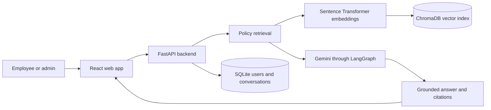

# PolicyPilot

PolicyPilot is a web app that helps employees find answers in company policy documents. Employees ask questions in a chat and receive answers based on the available policy files, with source citations they can open. Administrators manage the policy library through a separate workspace.

## Features

- Ask questions in plain language about leave, expenses, travel, remote work, IT security, and conduct.
- See which policy files support an answer and inspect the cited passages.
- Ask for an overview of all policies currently in the library.
- Check your own seeded leave balance and expense claim status through the assistant.
- Keep separate employee and administrator experiences.
- Upload policy files by dragging them onto the admin library or browsing for them. PDF, DOCX, and TXT files up to 10 MB are supported.
- Preview, replace, and delete policy files as an administrator.
- Save conversations and return to them later.
- Copy assistant answers and mark them as helpful or not helpful. Feedback is currently a visual, session-only interaction and is not saved to the database.
- Show or hide the password on the sign-in and account-creation form.
- Fall back to the closest policy passage if Gemini is unavailable or no API key is configured.

## How it works



1. An administrator uploads a policy file, or the app starts with the bundled sample policies.
2. The backend extracts text and splits it into overlapping passages (800 characters with 120 characters of overlap by default).
3. A Sentence Transformers model turns passages into embeddings. ChromaDB stores them so the backend can find passages with meaning similar to a question.
4. For a specific question, the assistant searches policy passages and asks Gemini to answer from the retrieved text. The answer includes source references.
5. For a request to list all policies, the assistant reads all indexed policy documents and summarizes them. For an employee's own leave or expense information, it can use that employee's database record.

## Roles

| Role | What they can do |
|---|---|
| Employee | Ask policy questions, view cited sources, manage their own conversations, and ask about their own demo leave and expense data. |
| Admin | Use the admin overview, ask the assistant, and drag-and-drop or browse to upload, open, replace, or delete policy files. |

Self-registration creates an employee account. The admin demo account is seeded locally when the database is first created; admin accounts are not created through public registration.

## Using the interface

- **Sign in or register:** Employees can create an account from the login page. Registration creates an employee account; use the seeded admin demo account to open the admin workspace locally.
- **Ask a policy question:** Employees can choose a suggested question or type their own. Previous conversations appear in the chat sidebar.
- **Check the evidence:** Select a source under an answer to expand its matching passage. Use the copy button to copy an answer. The thumbs-up and thumbs-down buttons show a local selection but do not currently submit or store feedback.
- **Manage policy files:** Admins can open the policy library and drop a PDF, DOCX, or TXT file onto the upload area, or click it to browse. The interface checks the 10 MB limit before uploading and indexing. Admins can also preview, replace, or remove files.
- **Try the assistant as an admin:** Admins can open the employee-facing assistant to review answers and citations.

## Technology

| Area | Technology |
|---|---|
| Web interface | React 19, React Router, Vite |
| API | Python, FastAPI, Uvicorn |
| Answer generation and tools | Gemini, LangGraph, LangChain |
| Text embeddings | Sentence Transformers (`all-MiniLM-L6-v2`) |
| Semantic index | ChromaDB |
| User and conversation data | SQLite |
| Authentication | JWT access tokens and bcrypt password hashing |
| Supported policy files | PDF, DOCX, TXT |

## Project layout

```text
policy-assistant/
├── backend/
│   ├── app/                 # API, authentication, policy search, agent, and database code
│   │   ├── routers/         # Authentication, chat, and document endpoints
│   │   ├── agent.py         # LangGraph workflow and answer citations
│   │   ├── answer.py        # Gemini answer path and passage fallback
│   │   ├── config.py        # Paths, model, upload, and environment settings
│   │   ├── database.py      # SQLite schema and demo records
│   │   ├── ingestion.py     # PDF, DOCX, and TXT text extraction and chunking
│   │   ├── retrieval.py     # Embeddings and ChromaDB search
│   │   └── tools.py         # Policy, leave, and expense tools for the agent
│   ├── data/
│   │   ├── policies/        # Bundled sample policy files
│   │   ├── app.db           # Local SQLite data (created at runtime)
│   │   └── chroma/          # Local vector index (created at runtime)
│   ├── scripts/             # Ingest, search, evaluation, and terminal chat helpers
│   ├── .env.example         # Backend configuration template
│   └── requirements.txt
├── frontend/
│   ├── src/pages/           # Login, employee chat, admin overview, policy library
│   ├── src/components/      # Shared page layout, navigation, and icons
│   ├── src/api.js           # Frontend requests to FastAPI
│   ├── src/auth.jsx         # Login session state
│   ├── src/config.js        # App name and API URL
│   ├── .env.example         # Frontend API URL template
│   └── package.json
└── README.md
```

## Run locally on Windows

### Requirements

- Python 3.10 or newer
- Node.js and npm compatible with the installed Vite version
- A Google Gemini API key for generated answers. Without it, the backend returns the closest policy passage instead.

### 1. Set up the backend

Open a terminal in the project root and run:

```powershell
cd backend
python -m venv .venv
.\.venv\Scripts\Activate.ps1
python -m pip install -r requirements.txt
Copy-Item .env.example .env
```

Open `backend/.env` and set `GEMINI_API_KEY` to your own key. Keep this file private and out of Git. You can also update `SECRET_KEY` and `CORS_ORIGINS` there.

Start the API:

```powershell
uvicorn app.main:app --reload
```

The API runs at `http://127.0.0.1:8000`. Interactive API documentation is available at `http://127.0.0.1:8000/docs`.

### 2. Set up the frontend

In a second terminal, from the project root:

```powershell
cd frontend
npm install
Copy-Item .env.example .env
npm run dev
```

Open `http://localhost:5173`. The frontend's default API URL is `http://127.0.0.1:8000`; set `VITE_API_URL` in `frontend/.env` if your backend runs elsewhere.

On first startup, the backend creates the local SQLite tables and indexes the bundled policy files if the vector index is empty. The first embedding-model load may take a little time.

## Deploy to Render and Vercel

The repository includes `render.yaml` for the FastAPI backend. The frontend can be deployed as a Vite site on Vercel using the included `frontend/vercel.json` rewrite for React Router.

### Backend on Render

1. Push the project to GitHub and connect the repository to Render.
2. Create a new Blueprint and select this repository. Render reads `render.yaml` and creates the API service with a persistent disk mounted at `/var/data`.
3. When prompted, set a private `INITIAL_ADMIN_USERNAME` and `INITIAL_ADMIN_PASSWORD`, and optionally a `GEMINI_API_KEY`. The blueprint disables the public demo accounts and generates a JWT secret. Keep all secrets in Render, never in the repository.
4. Wait for the service to deploy, then note its URL, for example `https://policypilot-api.onrender.com`.

The service uses Render's `1c-2g` compute plan (1 CPU, 2 GB RAM) to give the embedding model and its dependencies enough memory headroom. It stores SQLite, uploaded policies, and ChromaDB under `/var/data`, so those files survive deploys and restarts. Render currently lists this compute plan at about $40/month; a 1 GB persistent disk adds about $0.25/month. Check [Render pricing](https://render.com/pricing) before creating the service. Free web services do not support persistent disks, so they are suitable only for a disposable preview of this app.

### Frontend on Vercel

1. Import the same GitHub repository into Vercel.
2. Set the Root Directory to `frontend` and use the Vite defaults (`npm run build`, output directory `dist`).
3. Add the environment variable `VITE_API_URL` with the Render API URL, including `https://`, then deploy.
4. Copy the deployed frontend URL. In the Render API service's environment settings, set `CORS_ORIGINS` to that URL, for example `https://policypilot.vercel.app`. Include comma-separated local origins too if you still need local development.

Vercel's Hobby plan is listed as free for personal projects; review [Vercel plans](https://vercel.com/docs/plans) for its current terms and limits. After changing environment variables, redeploy the affected service so the new values take effect.

### Before making it public

- Replace the sample `ACME Corp` policies with approved company policy content.
- The Render configuration disables seeded demo accounts and creates an initial admin from private environment variables. Do not reuse demo credentials for a public deployment.
- Keep `GEMINI_API_KEY` in Render's secret environment variables; never put it in frontend code or GitHub.
- Set `CORS_ORIGINS` to the exact deployed frontend origin.
- Review the service URL and hosting costs before confirming the deployment.

## Demo accounts

The local seed accounts are:

| Role | Username | Password |
|---|---|---|
| Employee | `employee` | `employee123` |
| Admin | `admin` | `admin123` |

These are development demo credentials. Change or remove them before deploying the app or entering real employee information. New accounts registered in the app receive the employee role.

## Bundled sample policies

The sample policy library includes:

- `leave_policy.txt`
- `expense_policy.txt`
- `travel_policy.txt`
- `remote_work_policy.txt`
- `it_security_policy.txt`
- `code_of_conduct.txt`

The sample files and assistant prompt use **ACME Corp** as a fictional placeholder company name. Replace it with the correct organization name and approved policy content before presenting the app as an organization's official policy source.

## Useful backend commands

Run these from `backend/` after activating the virtual environment:

```powershell
# Re-index all supported files in backend/data/policies
python -m scripts.ingest

# Search the policy index directly
python -m scripts.search "How many sick days do I get?"

# Measure retrieval on the bundled evaluation questions
python -m scripts.evaluate

# Ask the assistant from the terminal (requires GEMINI_API_KEY)
python -m scripts.ask_agent "How many leave days do I have left?"
```

## Configuration and local data

- `backend/.env` holds private settings such as the Gemini API key and JWT secret. Do not commit it.
- `backend/data/app.db` stores users, conversations, messages, seeded leave balances, and demo expenses.
- `backend/data/chroma/` stores the local policy search index.
- `backend/data/policies/` contains the source policy files. Admin uploads are saved here.
- `frontend/.env` can set `VITE_API_URL` for the backend address.

The database and vector index are local development data. Back them up separately if you need to preserve them; they are not source code.

## Security and project status

This is a development project with demo accounts and seeded employee records. Before using it with real employees, replace demo credentials and secrets, configure production hosting and CORS, review privacy and access requirements, and test the deployment's security. Uploaded policy files should contain approved content. Scanned PDFs that have no extractable text may need OCR before they can be searched.

## License

This project is licensed under the [MIT License](LICENSE). You may use, copy, modify, merge, publish, distribute, sublicense, and sell copies of the software, subject to the terms in the license file.
